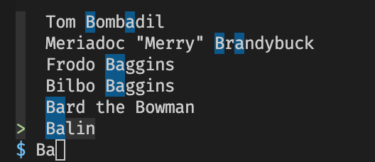

# fuzzy_finder

[](https://crates.io/crates/fuzzy_finder)

`fuzzy_finder` is a fuzzy finding UI for Rust CLI applications, built on [crossterm](https://github.com/crossterm-rs/crossterm).

Does your CLI app have a big list of things your users want to search through? If so you might find this library helpful. It looks like this:



## Usage

Wrap whatever you want to search through in an `Item`, giving it the string to match against, then call `find`:

```rust
use fuzzy_finder::{item::Item, FuzzyFinder};

let items = vec![
    Item::new("Frodo Baggins".to_string(), 1),
    Item::new("Samwise Gamgee".to_string(), 2),
];

// Renders the finder below the cursor, eight lines high, and blocks
// until the user selects an item (Enter) or quits (Esc, ctrl-c, ctrl-d).
let selection: Option<i32> = FuzzyFinder::find(items, 8)?;
```

It comes with a Lord of the Rings example, which you can run like this:
```
cargo run --example lotr
```

Here's a little demo:
[](https://asciinema.org/a/kXov19ul80aSRmMLgWrleHkL9)

The design owes a great debt to the wonderful [fzf](https://github.com/junegunn/fzf).

## History

`fuzzy_finder` was developed for [lk](https://github.com/jamescoleuk/lk), a CLI front-end for bash scripts.